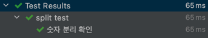

AssertJ Junit5 에서 @DisplayName를 했는데 표시 안되는 경우가 있다.
이 경우 아래와 같이 설정해주면 된다.

1. Build, Execution, Deployment -> Build Tools -> Gradle로 이동한 다음 Run tests using 을 Gradle -> Intellij IDE 로 수정

그러면 아래와 같이 나오게 된다.

