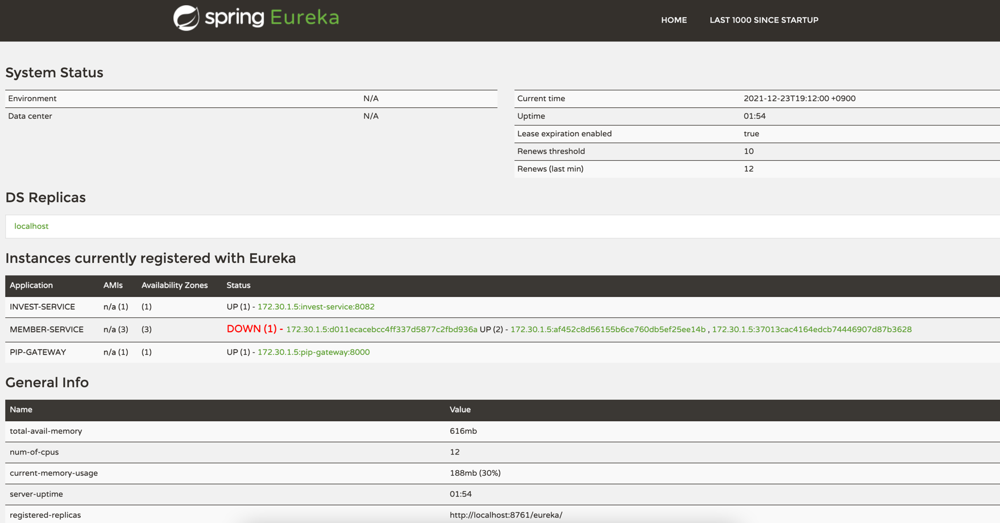

### MSA Eureka의 역할

MSA 에서 등록되어 있는 서버를 관리한다.
각 서비스에 등록된 정보를 확인할 수 있고. 각 어플리케이션의 서버가 어떤 IP와 Port 로 등록되어 있는지 확인할 수 있다. 
Port를 직접 등록할 수도 있고, random port 를 산정할 수 있다. 

### Load Balancing

각각의 서비스를 분산하여 등록하고, 부하에 따라 서비스를 분산 처리할 수 있다. 
동적인 탐색을 제공한다. 

